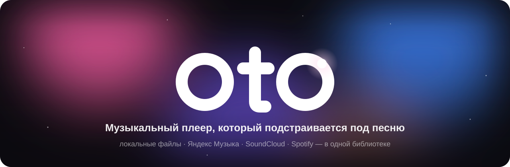
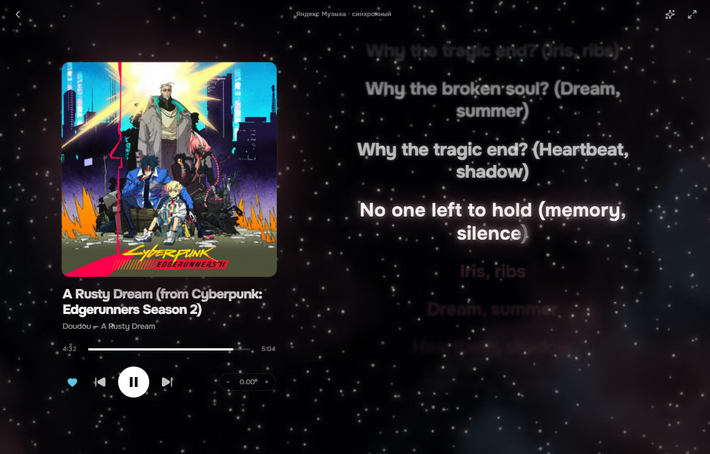
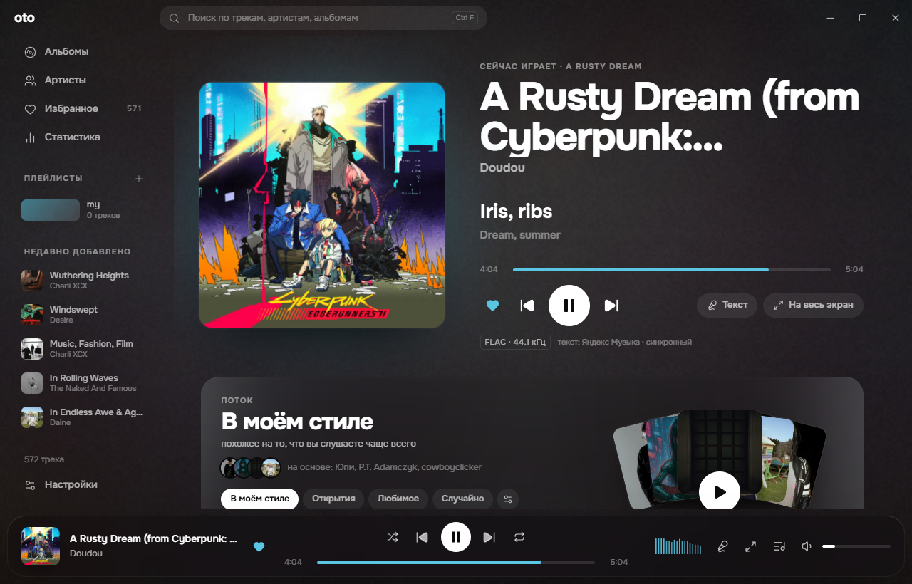
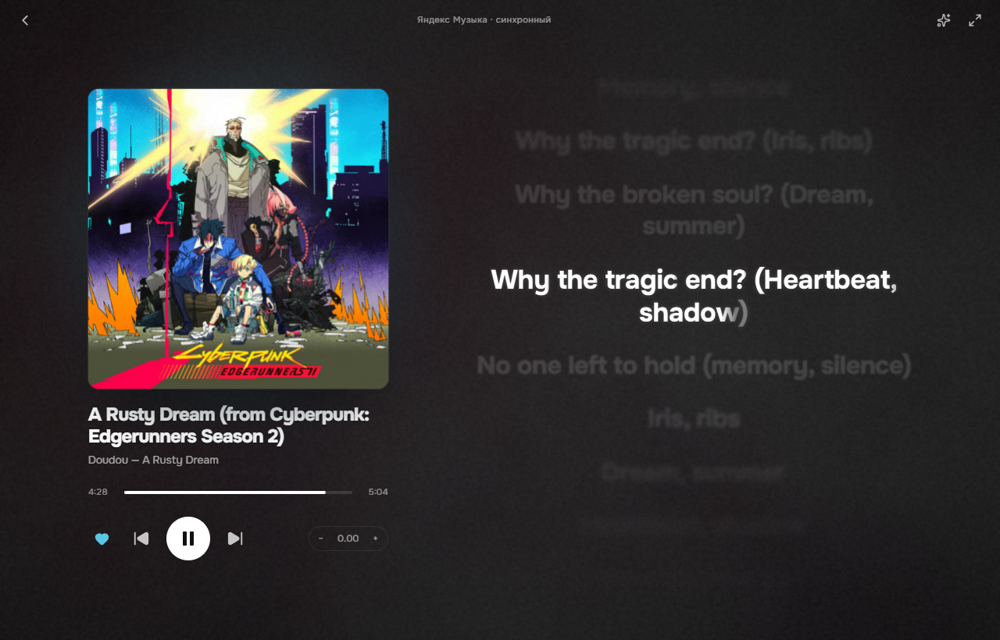
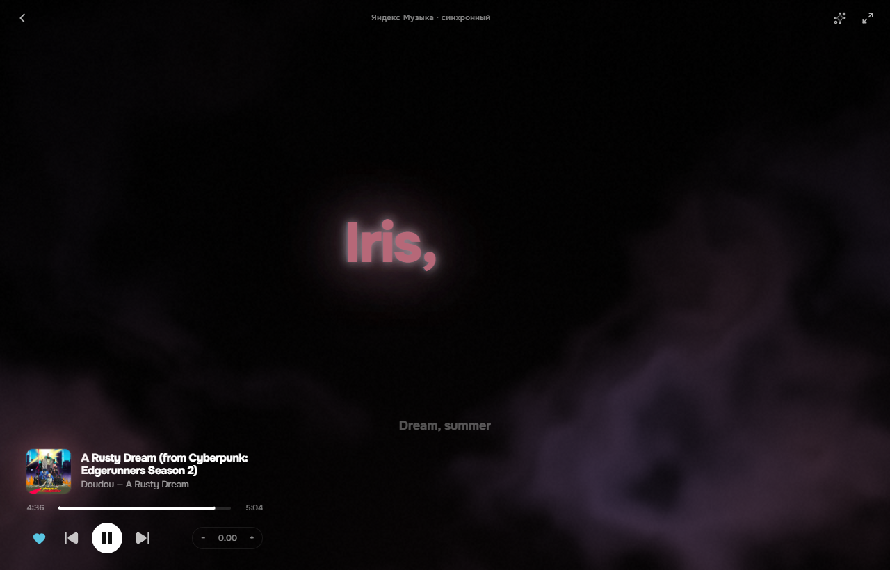
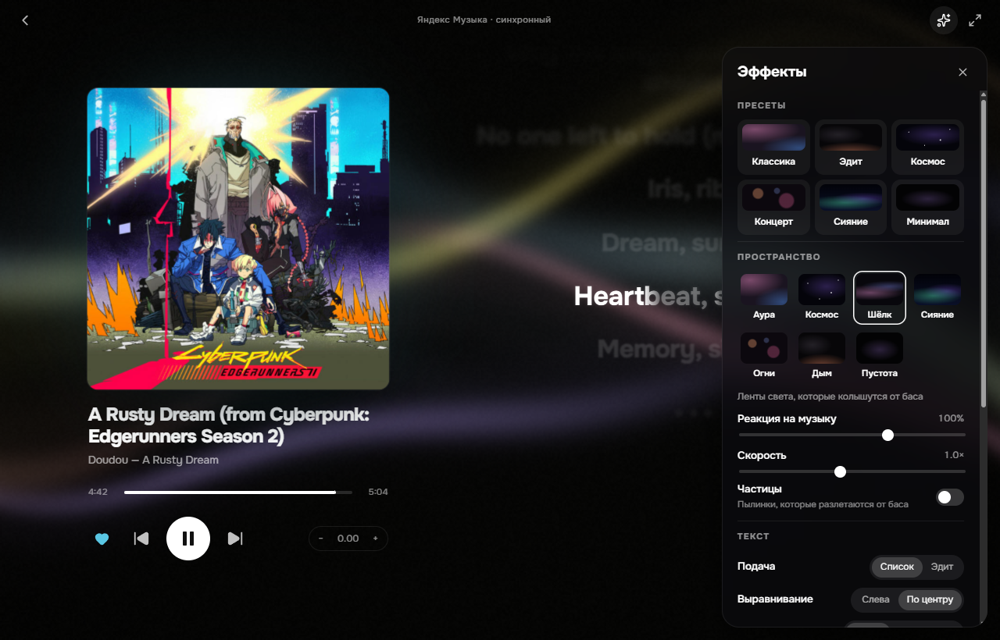
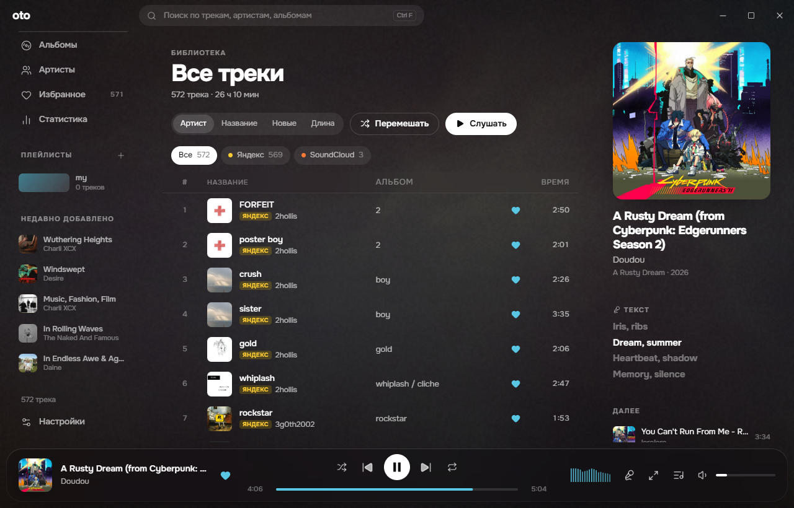
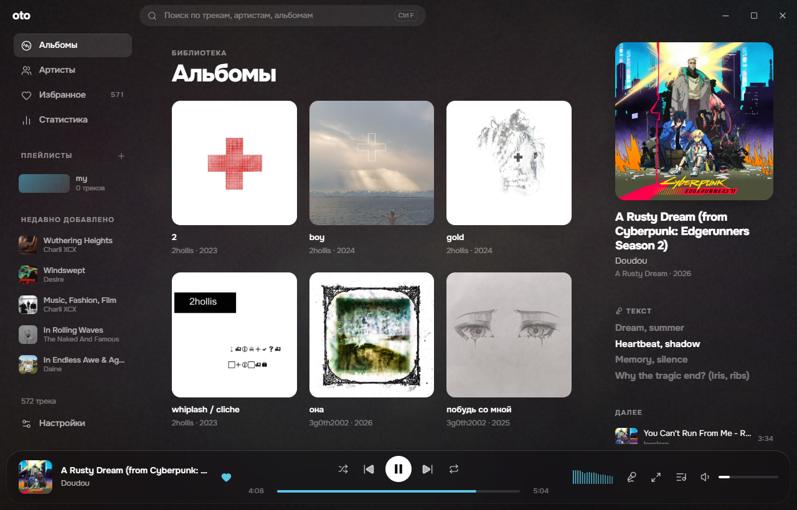
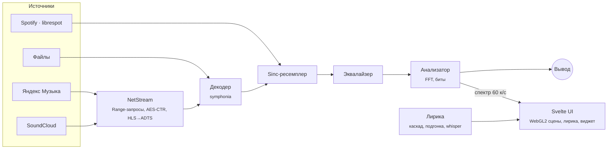

<p align="center">
  
</p>

<p align="center">
  <a href="#возможности">Возможности</a> ·
  <a href="#как-это-выглядит">Скриншоты</a> ·
  <a href="#запуск">Запуск</a> ·
  <a href="#как-это-устроено">Как устроено</a> ·
  <a href="#горячие-клавиши">Клавиши</a>
</p>

<p align="center">
  
  
  
  
  <a href="LICENSE"></a>
</p>

<br>

<p align="center">
  
</p>

**oto** — десктопный плеер, в котором музыка из папок, Яндекс Музыки, SoundCloud и Spotify
живёт в одной библиотеке, текст поётся синхронно с голосом, а весь интерфейс окрашивается
под обложку и дышит в такт треку. Написан на Rust: свой аудиодвижок, свой поток из сети,
своя подгонка лирики.

## Возможности

### Одна библиотека из всех источников

- **Локальные файлы** — MP3, FLAC, OGG/Opus, AAC/M4A, ALAC, WAV, AIFF; теги, обложки, палитра обложки.
- **Яндекс Музыка** — вход через окно Яндекса, импорт «Мне нравится» в том же порядке, **lossless FLAC** с подпиской.
- **SoundCloud** — публичные треки без входа, лайки после входа.
- **Spotify** — через librespot, 320 кбит/с (нужен Premium).
- **Глобальный поиск** по библиотеке и всем сервисам сразу: видно, откуда трек, карточки исполнителей и альбомов.
- **Склейка копий**: одна песня из файла и из сервиса показывается один раз. Если источник недоступен, играет другая копия.
- **Один лайк** — и трек в библиотеке.

### Звук

- **Почти мгновенный старт**: стрим из Яндекса в lossless начинает играть примерно через 0,2 с,
  перемотка в любое место занимает десятки миллисекунд. Следующий трек открывается заранее.
- **Честный ресемплинг**: polyphase windowed-sinc (64 отвода, окно Кайзера) вместо линейной
  интерполяции. Около 100 дБ чистоты против 20 дБ на 10 кГц у стандартного конвертера.
- **10-полосный эквалайзер** с пресетами, **кроссфейд**, **gapless** (и для стримов тоже).
- **Анализ спектра на 60 к/с**: 48 полос, бас, середина, верх, детектор битов. От него живут фон, частицы, текст и виджет.

### Лирика

- **Каскад источников**: `.lrc` рядом с файлом → теги → текст из сервиса → LRCLIB → Яндекс.
  Синхронный текст из любого источника важнее простого.
- **Подгонка под запись**: если текст снят с другой версии песни, сдвиг и темп подбираются по атакам вокала.
- **Слова точно по голосу** (по желанию): локальное распознавание речи (whisper.cpp) слушает
  песню и расставляет каждое слово туда, где его поют. Работает на компьютере, без сети.
  Текст без таймкодов становится полностью синхронным.
- **Две подачи**: прокручиваемый список с караоке-заливкой или **«Эдит»** — одна крупная строка,
  слова проявляются по мере пения.
- **Подсветка** припева, финала песни и только что спетых строк; свечение, удар в такт, цвет из обложки.

### Визуал

- **7 пространств** за текстом, все на шейдерах и все слушают музыку:
  Аура, Космос, Шёлк, Сияние, Огни, Дым, Пустота.
- **Панель эффектов** прямо в режиме лирики, с пресетами: изменения видны сразу.
- **5 тем**, которые меняют раскладку, а не только цвета: Aura, Noir, Mist,
  **Liquid** (настоящее преломление через SVG displacement), Paper.
- **Полный экран**: интерфейс и курсор прячутся, остаются музыка и слова.

### «Поток»

Бесконечная станция по тому, что ты **реально слушаешь** (а не по лайкам): время прослушивания
с поправкой на давность и пропуски. Режимы «В моём стиле», «Открытия», «Любимое», «Случайно»,
ползунок «знакомое ↔ новое». Пропуск убирает исполнителя до конца сессии.

### Всегда под рукой

- **Виджет** поверх окон или на рабочем столе: сквозь клики, прозрачность, своё пространство на фоне, строка лирики.
- **Discord**: «Слушает» в профиле с обложкой, полосой прогресса, ссылкой на трек и кнопкой на этот репозиторий.
- **Трей** со стеклянной панелью управления.
- **Глобальные хоткеи** и плашка медиа Windows (SMTC).
- **Статистика**: время, серии дней, топ артистов и треков, теплокарта «день × час».

## Как это выглядит

<table>
  <tr>
    <td width="50%"><p align="center"><sub>Главная: сейчас играет, «Поток», миксы</sub></p></td>
    <td width="50%"><p align="center"><sub>Лирика: караоке-заливка и глубина резкости</sub></p></td>
  </tr>
  <tr>
    <td width="50%"><p align="center"><sub>«Эдит» в пространстве «Дым»</sub></p></td>
    <td width="50%"><p align="center"><sub>Панель эффектов: «Шёлк»</sub></p></td>
  </tr>
  <tr>
    <td width="50%"><p align="center"><sub>Библиотека с фильтром по источникам</sub></p></td>
    <td width="50%"><p align="center"><sub>Альбомы</sub></p></td>
  </tr>
</table>

## Запуск

Нужны Windows 10/11, [Rust](https://rustup.rs) (stable), Node 20+ и Visual Studio 2022 Build Tools
(C++). WebView2 уже есть в Windows 11.

```powershell
npm install
npm run tauri dev
```

Установщик (NSIS):

```powershell
npm run tauri build
```

Тесты ядра (ресемплер, эквалайзер, поток, LRC, подгонка, выравнивание слов):

```powershell
cd src-tauri; cargo test --lib
```

> [!NOTE]
> Распознавание речи собирает whisper.cpp через CMake и Ninja из Visual Studio Build Tools.
> Пути к ним прописаны в `src-tauri/.cargo/config.toml`; если Build Tools стоят в другом месте,
> поправь их там. Без распознавания: `cargo build --no-default-features`.

### Дизайн в браузере

`npm run dev` и http://localhost:1430: без Tauri подключается мок-бэкенд с демо-библиотекой и
симуляцией спектра (`src/dev/mock.ts`, в сборку не попадает). Виджет и трей открываются как
`?w=widget` и `?w=flyout`.

## Как это устроено



```
src-tauri/src/
  audio.rs          движок: очередь, фоновая загрузка, gapless, кроссфейд, анализатор
  stream.rs         сетевой поток с произвольным доступом и расшифровкой
  resample.rs       polyphase sinc-ресемплер
  eq.rs             10-полосный эквалайзер
  providers/        Яндекс Музыка, SoundCloud, Spotify
  lyrics/           каскад, LRC, LRCLIB, подгонка по вокалу, wordsync/ (whisper)
  station.rs        «Поток»
  library.rs  db.rs  stats.rs  shell.rs (трей, виджет, хоткеи, SMTC)
src/
  lib/gl/           шейдерные пространства, частицы
  lib/components/   lib/views/   windows/ (виджет, трей)
```

Подробнее о решениях — в [docs/DESIGN.md](docs/DESIGN.md).

## Горячие клавиши

| Глобально | |
|---|---|
| <kbd>Ctrl</kbd>+<kbd>Alt</kbd>+<kbd>Space</kbd> | играть / пауза |
| <kbd>Ctrl</kbd>+<kbd>Alt</kbd>+<kbd>→</kbd> / <kbd>←</kbd> | следующий / предыдущий |
| <kbd>Ctrl</kbd>+<kbd>Alt</kbd>+<kbd>Shift</kbd>+<kbd>→</kbd> / <kbd>←</kbd> | ±10 с |
| <kbd>Ctrl</kbd>+<kbd>Alt</kbd>+<kbd>↑</kbd> / <kbd>↓</kbd> | громкость |
| <kbd>Ctrl</kbd>+<kbd>Alt</kbd>+<kbd>L</kbd> | лайк |
| <kbd>Ctrl</kbd>+<kbd>Alt</kbd>+<kbd>W</kbd> | виджет |
| <kbd>Ctrl</kbd>+<kbd>Alt</kbd>+<kbd>O</kbd> | виджет: сквозь клики |

В окне: <kbd>Space</kbd> пауза, <kbd>←</kbd>/<kbd>→</kbd> ±5 с (с <kbd>Shift</kbd> ±15 с),
<kbd>L</kbd> лирика, <kbd>Q</kbd> очередь, <kbd>F11</kbd> полный экран, <kbd>Ctrl</kbd>+<kbd>F</kbd> поиск.
Все глобальные сочетания настраиваются.

<details>
<summary><b>Отладка живого окна</b></summary>

Если запустить с `WEBVIEW2_ADDITIONAL_BROWSER_ARGUMENTS=--remote-debugging-port=9333`, скрипты в
`scripts/` выполняют JS, кликают и снимают скриншоты окон приложения через DevTools
(`cdp.mjs`, `cdp-click.mjs`, `cdp-drag.mjs`, `cdp-shot.mjs`).
</details>

## Лицензия

[MIT](LICENSE) © kaneyesrts. Встроенный [whisper.cpp](src-tauri/vendor/whisper-rs-sys/whisper.cpp/LICENSE) распространяется под своей лицензией MIT.

---

<sub>API Яндекс Музыки и SoundCloud неофициальные и могут меняться. Токены входа хранятся только
на твоём компьютере. Обложки на скриншотах принадлежат их правообладателям.</sub>
